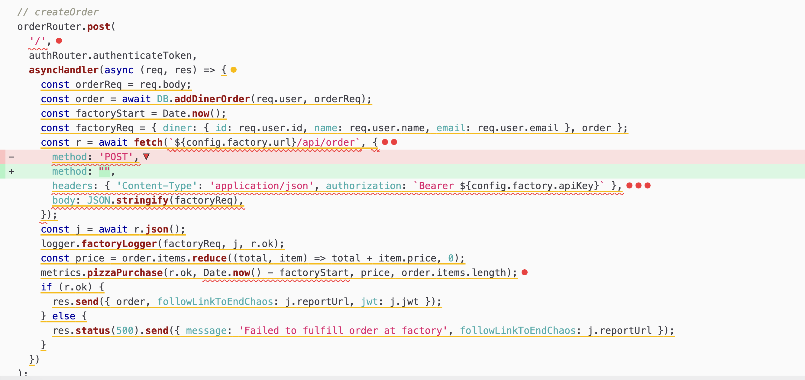

# Curiosity Report: Mutation Testing with Stryker

> **Question:** jwt-pizza-service has **97.7% line coverage**. Does that mean my tests would catch 97.7% of bugs?
>
> **Short answer:** No. Stryker's first answer was **74.8%**, and after controlling for flaky, load-dependent timeouts the trustworthy answer was **~68%**.

## Why I was curious
I chose Stryker because I have started writing code at work that needs to be tested. I wrote a lot of tests for jwt-pizza-service in this class, but I was curious which of them actually mattered. At work we don't have a coverage threshold to meet; I just have to make sure the code works. That made me wonder what a coverage number really tells you, and mutation testing felt like a good way to understand which kinds of tests are actually helpful and what I should focus on when writing them.

## What is mutation testing?

Mutation testing checks how well your tests actually assess what your code does. Stryker makes small changes ("mutants") to the source code, like changing `true` to `false`, `>` to `>=`, `some` to `every`, or a string to `""`. These are changes that should break the code. If you run your tests against a mutant and they all still pass, your tests are probably not as rigorous as you thought. Some changes won't actually affect behavior (these are called *equivalent mutants*, see Experiment 3), but most will.

Each mutant ends up with one of these statuses:

| Status | Meaning | Counts as |
|---|---|---|
| Killed | At least one test failed | Detected (good) |
| Timeout | The change made the tests hang (e.g. an infinite loop or a request that never finishes) | Detected |
| Survived | Every test still passed | Not detected (a gap in the tests) |
| No coverage | No test even runs that code | Not detected |
| Compile / Runtime error | The mutant was invalid code | Left out of the score |
| Ignored | Excluded on purpose with a `// Stryker disable` comment | Left out of the score |

That gives the mutation score:

```
mutation score = (killed + timeout) / (killed + timeout + survived + no coverage)
```

Stryker counts timeouts as kills because the tests did not pass, which would signal a problem. (Experiment 4 shows this assumption can go wrong.)

### How Stryker runs

1. **Sandbox.** Stryker copies the project into `.stryker-tmp/`, so the real source files are never changed.
2. **Mutation switching.** Instead of building a separate copy of the code for every mutant, Stryker parses each file into a syntax tree and writes *all* mutants into the code at once. Each one is wrapped in a check against a global "active mutant" id, and only one is switched on at a time. That way the code is loaded once instead of once per mutant.
3. **Dry run.** Stryker runs the whole test suite with no mutant active. This confirms the tests pass, and with `coverageAnalysis: 'perTest'` it also records which tests run which mutants.
4. **Mutation run.** For each mutant, Stryker switches it on and runs only the tests that cover it, stopping at the first failure. Mutants that no test covers are marked "No coverage" without running anything.
5. **Static mutants.** Code that runs only once when a module loads (like jwt-pizza's top-level `docs` arrays) can't be switched on later, so Stryker has to rerun *all* the tests for those mutants. They are the most expensive kind.

## How I researched it

I researched this in two ways: reading, and testing my assumptions against my own code.

**Reading**

- **The Stryker documentation** for configuring the Jest runner and understanding the options I ended up experimenting with: `coverageAnalysis`, `concurrency`, `timeoutMS`, running on a line range with `--mutate "file:start-end"`, and `// Stryker disable` comments.
- **Stryker's blog post on mutation switching** and its **docs on static mutants**. These explained how Stryker can test 1,125 mutants in about 5 minutes, and why the `docs` array mutants in my report always said "Ran all tests for this mutant."
- **DeMillo, Lipton & Sayward (1978)**, the paper that introduced mutation testing. It argues that programmers write code that is *almost* correct (the "competent programmer hypothesis"), so tests that catch small mistakes will also catch bigger ones (the "coupling effect").
- **Petrović & Ivanković (2018), "State of Mutation Testing at Google"**, on how mutation testing works at a company with a huge codebase.
- **Meta's 2025 paper on mutation-guided test generation**, on how mutants are now being combined with LLMs.

**Hands-on**

- I read Stryker's terminal output and the interactive HTML report file by file, then went to the source code to understand *why* each mutant survived instead of just looking at the percentage.
- Before trusting a surviving mutant, I applied the same mutation **by hand** and ran the tests myself, to make sure I understood exactly what Stryker was reporting.
- When I suspected a mutant was equivalent, I wrote a small Express app to prove it (Experiment 3) instead of assuming.
- When the scores changed between runs, I treated it as a question to investigate rather than noise, which became Experiment 4.

## Current state of the art

**Where it came from.** Mutation testing is older than most of the tools we use in this class. The idea was proposed by Richard Lipton in the early 1970s and formalized by DeMillo, Lipton and Sayward in 1978. For decades it was mostly an academic technique because it was too expensive: you had to compile and run the whole test suite once per mutant.

**Tools today.** Faster computers and tricks like mutation switching and per-test coverage have made it practical:

| Language | Tool |
|---|---|
| JavaScript / TypeScript | **Stryker** (StrykerJS) |
| C# | Stryker.NET |
| Scala | Stryker4s |
| Java | PIT (pitest) |
| Python | mutmut |
| Rust | cargo-mutants |

**How large companies use it.** Google doesn't run mutation testing on the whole codebase, because that would be far too expensive. Instead, it generates a few mutants only on the **lines changed in a code review** and shows surviving ones to the reviewer as comments. It also skips "uninteresting" code like logging, so developers only see mutants worth acting on. More recently, Meta has combined mutation testing with LLMs: its ACH tool generates mutants aimed at specific kinds of bugs (like privacy issues), then uses an LLM to write tests that kill them, and to help detect equivalent mutants.

**Problems that are still open.**

- **Cost.** Every mutant means another test run. My full run took 5–45 minutes depending on settings, compared with 3.4 seconds for the normal test suite.
- **Equivalent mutants.** In general, no tool can automatically decide whether a mutant really changes behavior, so a person (or now an LLM) has to judge, like I did in Experiment 3.
- **Noise.** Survivors in code nobody cares about (like my `docs` arrays) make the score look worse than the tests really are. This is why Google filters what it shows developers.
- **Flaky tests.** A mutation score is only as reliable as the tests underneath it. Experiment 4 shows this directly.

---

## Experiments

All experiments were run against my fork of [jwt-pizza-service](https://github.com/Cate444/jwt-pizza-service).

| Tool | Version |
|---|---|
| Node.js | 22.23.3 |
| Jest | 29.7.0 |
| Express | 4.22.2 |
| supertest | 6.3.4 |
| @stryker-mutator/core | 10.1.1 |
| @stryker-mutator/jest-runner | 10.1.1 |
| Database | Local MySQL (the router tests hit a real database) |
| Machine | 12-core Mac |

### Setup (reproduction steps)

From the root of jwt-pizza-service, with MySQL running and the normal tests passing:

```bash
npm install --save-dev @stryker-mutator/core @stryker-mutator/jest-runner
```

Then create `stryker.config.mjs`:

```js
// @ts-check
/** @type {import('@stryker-mutator/api/core').PartialStrykerOptions} */
const config = {
  // Use Jest to run the tests against each mutant
  testRunner: 'jest',
  jest: {
    configFile: 'jest.config.json',
  },

  // Which source files to mutate: app code only, not tests or startup scripts
  mutate: [
    'src/**/*.js',
    '!src/**/*.test.js',
    '!src/testHelpers.js',
    '!src/index.js',
    '!src/init.js',
    '!src/config.js', // settings and secrets: not logic, and keeps secrets out of the HTML report
  ],

  // Only run the tests that actually cover each mutant (big speedup)
  coverageAnalysis: 'perTest',

  // clear-text = table in terminal, html = interactive report, json = raw data
  reporters: ['progress', 'clear-text', 'html', 'json'],

  // Don't copy these folders into Stryker's sandbox
  ignorePatterns: ['coverage', 'test-results', 'reports', 'jest'],
};

export default config;
```

And add Stryker's output to `.gitignore`:

```
.stryker-tmp
reports
```

Run it with:

```bash
npx stryker run
```

The interactive report is written to `reports/mutation/mutation.html`.

> **⚠️ Watch out: the HTML report contains your source code, including secrets.**
> Stryker's HTML report is a single self-contained file that embeds the full source of **every file it mutates**, so it can highlight mutants line by line. My first config didn't exclude `src/config.js`, so the report ended up containing my JWT secret, database password and API keys, even though `config.js` itself is gitignored. I only noticed when I copied the report into another repo to take a screenshot. Mutating a settings file is also pointless (`config.js` scored 35% because blanking out a password just breaks the connection), so I added `'!src/config.js'` to `mutate`. Experiments 1 and 4 were run before this change, so their totals still include `config.js`'s mutants. Lesson: treat mutation reports like build artifacts. Keep them gitignored, and never mutate files that hold secrets.

### Experiment 1: Coverage vs. mutation score (baseline)

First I recorded the normal Jest results (`npx jest`): **76 tests, 97.71% line coverage, 90.55% branch coverage, ~3.4 s.**

Then I ran Stryker on the unchanged tests:

```
---------------------|------------------|----------|-----------|------------|----------|----------|
                     | % Mutation score |          |           |            |          |          |
File                 |  total | covered | # killed | # timeout | # survived | # no cov | # errors |
---------------------|--------|---------|----------|-----------|------------|----------|----------|
All files            |  74.80 |   76.72 |      756 |        78 |        253 |       28 |       10 |
 database            |  75.14 |   80.81 |      269 |         9 |         66 |       26 |        0 |
  database.js        |  74.44 |   80.24 |      259 |         9 |         66 |       26 |        0 |
  dbModel.js         | 100.00 |  100.00 |       10 |         0 |          0 |        0 |        0 |
 model               | 100.00 |  100.00 |        5 |         0 |          0 |        0 |        0 |
  model.js           | 100.00 |  100.00 |        5 |         0 |          0 |        0 |        0 |
 routes              |  63.48 |   63.64 |      195 |        57 |        144 |        1 |        1 |
  authRouter.js      |  95.74 |   96.77 |       85 |         5 |          3 |        1 |        1 |
  franchiseRouter.js |  61.87 |   61.87 |       62 |        24 |         53 |        0 |        0 |
  orderRouter.js     |  45.12 |   45.12 |       29 |         8 |         45 |        0 |        0 |
  userRouter.js      |  47.56 |   47.56 |       19 |        20 |         43 |        0 |        0 |
 config.js           |  35.00 |   35.00 |        7 |         0 |         13 |        0 |        1 |
 endpointHelper.js   | 100.00 |  100.00 |        1 |         1 |          0 |        0 |        2 |
 logger.js           |  92.45 |   92.45 |       98 |         0 |          8 |        0 |        4 |
 metrics.js          |  90.86 |   91.38 |      157 |         2 |         15 |        1 |        2 |
 service.js          |  82.50 |   82.50 |       24 |         9 |          7 |        0 |        0 |
---------------------|--------|---------|----------|-----------|------------|----------|----------|
Ran 23.69 tests per mutant on average.
Done in 5 minutes and 19 seconds.
```

| File | Line coverage | Mutation score |
|---|---|---|
| **All files** | **97.71%** | **74.80%** |
| orderRouter.js | 100% | 45.12% |
| userRouter.js | 100% | 47.56% |
| franchiseRouter.js | 100% | 61.87% |
| authRouter.js | 97.77% | 95.74% |

**Observations**

- Stryker generated **1,125 mutants**. Running them took **5 min 19 s**, compared with 3.4 s for one normal test run.
- `orderRouter.js` has 100% line coverage, but more than half of its mutants survived. Every line *runs* during the tests, but many lines are never *checked*.
- The raw score needs a closer look before you trust it. Of the 144 survivors in the routers, **120 are in the `docs` arrays** (API documentation strings). Only **24 are in real route logic**.



*Stryker's HTML report for `createOrder` in `orderRouter.js`. Each red dot is a surviving mutant. The selected one changes `method: 'POST'` to `""`, and every test still passes. This is the bug fixed in Experiment 2B.*

### Experiment 2: Killing surviving mutants

To decide which survivors to fix, I asked four questions about each one:

1. If this change shipped to production, would anything break? → If yes, it's a **real test gap**.
2. Does the code behave differently at all? → If no, it's an **equivalent mutant** (see Experiment 3).
3. Does anyone depend on this value (e.g. error message text)? → If not, it's **debatable**.
4. Am I picking a variety of mutant types?

For each chosen mutant I (1) wrote a test, (2) applied the mutation **by hand** to prove the new test fails against it, (3) restored the file with `git checkout`, and (4) reran Stryker on just that code.

#### A. `some` → `every` in franchise store permissions (MethodExpression)

```diff
// src/routes/franchiseRouter.js:118 and :133 (createStore / deleteStore)
- if (!franchise || (!req.user.isRole(Role.Admin) && !franchise.admins.some((admin) => admin.id === req.user.id))) {
+ if (!franchise || (!req.user.isRole(Role.Admin) && !franchise.admins.every((admin) => admin.id === req.user.id))) {
```

**Why it survived:** every franchise in the tests had exactly **one** admin. With one admin, "some admin is me" and "every admin is me" mean the same thing. With two admins, the mutant would lock a real co-owner out of their own franchise.

**The new test** (`src/routes/franchiseRouter.test.js`):

```js
// Mutation testing found that every franchise in these tests had a single admin,
// so changing `admins.some(...)` to `admins.every(...)` went unnoticed.
test('any co-owner of a multi-admin franchise can create and delete a store', async () => {
  const { user: coOwner, token: coOwnerToken } = await registerDiner();
  const sharedRes = await request(app)
    .post('/api/franchise')
    .set('Authorization', `Bearer ${adminToken}`)
    .send({ name: randomName(), admins: [{ email: franchisee.email }, { email: coOwner.email }] });
  const shared = sharedRes.body;

  const createRes = await request(app)
    .post(`/api/franchise/${shared.id}/store`)
    .set('Authorization', `Bearer ${coOwnerToken}`)
    .send({ name: 'Lehi' });
  expect(createRes.status).toBe(200);

  const deleteRes = await request(app)
    .delete(`/api/franchise/${shared.id}/store/${createRes.body.id}`)
    .set('Authorization', `Bearer ${coOwnerToken}`);
  expect(deleteRes.status).toBe(200);
});
```

**Proof, with the mutation applied by hand:**

```bash
sed -i '' 's/franchise\.admins\.some(/franchise.admins.every(/g' src/routes/franchiseRouter.js
npx jest src/routes/franchiseRouter.test.js --coverage=false -t "store"
git checkout -- src/routes/franchiseRouter.js
```

```
  ✓ franchisee can create and delete a store
  ✕ any co-owner of a multi-admin franchise can create and delete a store
  ✓ diner cannot create a store
  ✓ diner cannot delete a store
    Expected: 200
    Received: 403
```

The three old store tests all pass against the bug. Only the new test catches it.

**Stryker rerun** (`npx stryker run --mutate src/routes/franchiseRouter.js --reporters clear-text,progress`): both `every` mutants (lines 118 and 133) are now **Killed**.

#### B. Factory request URL, method, and auth header (StringLiteral / ObjectLiteral)

Seven mutants survived in the call to the pizza factory, including:

```diff
// src/routes/orderRouter.js:86-88 (createOrder)
- const r = await fetch(`${config.factory.url}/api/order`, {
+ const r = await fetch(``, {
-   method: 'POST',
+   method: "",
-   headers: { 'Content-Type': 'application/json', authorization: `Bearer ${config.factory.apiKey}` },
+   headers: { 'Content-Type': 'application/json', authorization: `` },
```

**Why they survived:** the test mocked `fetch`, but the only thing it checked about the call was

```js
expect(global.fetch).toHaveBeenCalledTimes(1);
```

That confirms `fetch` was called, but not *what* it was called with. In production, losing the API key would make every pizza order fail.

**The fix** (added to the `create order and get orders` test in `src/routes/orderRouter.test.js`, with `const config = require('../config.js');` at the top). The expected values come from `config` so the test never hard-codes the API key:

```js
// Mutation testing showed that only counting calls let the URL, method, and headers
// be blanked out without any test failing, so check exactly what is sent to the factory.
expect(global.fetch).toHaveBeenCalledWith(`${config.factory.url}/api/order`, {
  method: 'POST',
  headers: { 'Content-Type': 'application/json', authorization: `Bearer ${config.factory.apiKey}` },
  body: expect.any(String), // JSON string; its contents are checked below
});
const sentBody = JSON.parse(global.fetch.mock.calls[0][1].body);
expect(sentBody).toEqual({ diner: expect.objectContaining({ id: expect.any(Number), email: expect.any(String) }), order: createRes.body.order });
```

**Proof, with the auth header blanked by hand:**

```
  ✕ create order and get orders
    -     "authorization": "Bearer <API_KEY>",
    +     "authorization": "",
```

(Note: Jest prints the real API key in this diff. I replaced it with `<API_KEY>`.)

**Stryker rerun, only on the `createOrder` function:**

```bash
npx stryker run --mutate "src/routes/orderRouter.js:77-101" --reporters clear-text,progress
```

```
 orderRouter.js |  90.48 |   90.48 |       18 |         1 |          2 |        0 |        0 |
Done in 12 seconds.
```

All seven factory-request mutants are now killed. The two left are a latency calculation (`Date.now() - factoryStart` → `+`, which I left as a "debatable" example because it only affects a metric) and the `'/'` → `""` route path (Experiment 3). Limiting Stryker to a line range took this run from 5+ minutes down to **12 seconds**.

#### D. Delete-user response body (ObjectLiteral / StringLiteral)

```diff
// src/routes/userRouter.js:80
- res.json({ message: 'user deleted' });
+ res.json({});
```

**Why it survived:** the `admin can delete a user` test checks *behavior* well (the deleted user's token stops working and they can't log in), but it never looked at the response body. The diner test had the same gap for the `'unable to delete a user'` error message at line 76.

**The fix** (`src/routes/userRouter.test.js`):

```js
// in 'diner cannot delete a user'
expect(res.body.message).toBe('unable to delete a user');

// in 'admin can delete a user'
// Mutation testing showed the response body was never checked ({ message } -> {} survived).
expect(res.body).toEqual({ message: 'user deleted' });
```

**Stryker rerun** (`npx stryker run --mutate "src/routes/userRouter.js:70-82" --reporters clear-text,progress`):

```
 userRouter.js | 100.00 |  100.00 |        8 |         1 |          0 |        0 |        0 |
Done in 12 seconds.
```

#### Summary of Experiment 2

| | Mutant | Kind | Result |
|---|---|---|---|
| A | `admins.some` → `admins.every` | Real bug (authorization) | Killed by a new two-admin test |
| B | Factory URL / method / auth header blanked | Real bug (mock only counted calls) | Killed by `toHaveBeenCalledWith` |
| C | `Date.now() - start` → `+` | Debatable (metric only) | Left as is |
| D | `{ message: 'user deleted' }` → `{}` | Weak assertion | Killed by checking the body |
| E | `'/'` → `""` | Equivalent | Proven unkillable (Experiment 3) |

### Experiment 3: Proving an equivalent mutant

Several survivors looked like this:

```diff
// src/routes/franchiseRouter.js:60 (and similar lines in orderRouter.js)
- '/',
+ "",
```

My guess was that Express treats a route path of `""` the same as `'/'`, which would mean **no test could ever kill this mutant**. To check, I wrote `curiosity/equivalentMutant.js`. It mounts the same route twice, once with `'/'` and once with `""`, and sends the same requests to both:

```js
const express = require('express');
const request = require('supertest');

function buildApp(routePath, routerOptions = {}) {
  const router = express.Router(routerOptions);
  router.get(routePath, (req, res) => res.json({ matched: true }));

  const app = express();
  app.use('/api/franchise', router);
  app.use((req, res) => res.status(404).json({ matched: false }));
  return app;
}

const paths = ['/api/franchise', '/api/franchise/', '/api/franchise?name=x', '/api/franchise/extra'];

async function compare(label, routerOptions) {
  console.log(`\n${label}`);
  const original = buildApp('/', routerOptions);
  const mutant = buildApp('', routerOptions);
  let differences = 0;
  for (const path of paths) {
    const a = (await request(original).get(path)).status;
    const b = (await request(mutant).get(path)).status;
    if (a !== b) differences++;
    console.log(`  GET ${path.padEnd(24)} original '/': ${a}   mutant '': ${b}   ${a === b ? 'same' : 'DIFFERENT'}`);
  }
  console.log(`  -> ${differences === 0 ? 'EQUIVALENT: no request can tell them apart' : `${differences} request(s) differ: the mutant is killable`}`);
}

(async () => {
  await compare('Default router (how jwt-pizza-service is configured)', {});
  await compare('Router with { strict: true } (trailing slash matters)', { strict: true });
})();
```

```bash
node curiosity/equivalentMutant.js
```

```
Default router (how jwt-pizza-service is configured)
  GET /api/franchise           original '/': 200   mutant '': 200   same
  GET /api/franchise/          original '/': 200   mutant '': 200   same
  GET /api/franchise?name=x    original '/': 200   mutant '': 200   same
  GET /api/franchise/extra     original '/': 404   mutant '': 404   same
  -> EQUIVALENT: no request can tell them apart

Router with { strict: true } (trailing slash matters)
  GET /api/franchise           original '/': 200   mutant '': 404   DIFFERENT
  GET /api/franchise/          original '/': 200   mutant '': 404   DIFFERENT
  GET /api/franchise?name=x    original '/': 200   mutant '': 404   DIFFERENT
  GET /api/franchise/extra     original '/': 404   mutant '': 404   same
  -> 3 request(s) differ: the mutant is killable
```

**Result:** every router in jwt-pizza-service uses the default `express.Router()`, so this mutant is **equivalent** and no test can kill it. With `{ strict: true }` the same mutation *is* killable, so whether a mutant is equivalent depends on how the framework is configured, not just on the line of code.

Stryker lets you exclude equivalent mutants with a comment in the source code, which marks them as **Ignored** and removes them from the score:

```js
// Stryker disable next-line StringLiteral: Express treats '' and '/' the same (see curiosity/equivalentMutant.js)
'/',
```

I decided **not** to add these comments to jwt-pizza-service for now. They would make the score more accurate, but they put tool-specific comments into production code, and they could hide a real problem if the router configuration changed later (for example to `strict: true`, where this mutant *is* killable). If I used them, I would only add them for mutants I had actually proven equivalent, and always with a reason that points to the proof.

### Experiment 4: Performance and flakiness

During Experiment 2, rerunning Stryker on `franchiseRouter.js` showed that mutants in the `docs` array changed status between runs, even though no test checks them. Most of the ones that changed had been **Timeouts** in the first run, and Stryker counts a timeout as a kill. My hypothesis: by default Stryker ran **11 test processes in parallel** on my 12-core machine, all hitting the same MySQL database. Under that load some test runs exceeded Stryker's time limit, which **inflated the score**.

To test this, I ran the whole project six times with the **same tests** (including the A, B and D fixes), changing only Stryker settings. Each run has a small config that extends the main one, e.g. `curiosity/perf/R3.config.mjs`:

```js
// Performance experiment run R3: fewer parallel test processes
import base from '../../stryker.config.mjs';

export default {
  ...base,
  concurrency: 4,
  reporters: ['clear-text', 'json'],
  jsonReporter: { fileName: 'reports/perf/R3.json' },
};
```

| Run | Change from the main config |
|---|---|
| R1 | none (default: `perTest`, 11 processes, 5000 ms timeout) |
| R2 | none: identical to R1, to check repeatability |
| R3 | `concurrency: 4` |
| R4 | `timeoutMS: 20000` |
| R5 | `concurrency: 1` |
| R6 | `coverageAnalysis: 'off'` |

`curiosity/perf/runPerf.sh` runs them **one at a time** (so runs don't add load to each other) and records how long each takes, and `curiosity/perf/summarize.js` reads each JSON report and prints a table:

```bash
bash curiosity/perf/runPerf.sh        # ~1.5 hours total
node curiosity/perf/summarize.js
```

```
┌──────┬─────────────┬────────┬─────────┬──────────┬────────┬─────────┬──────────────────────┐
│ run  │ time (m:ss) │ killed │ timeout │ survived │ no cov │ score % │ score w/o timeouts % │
├──────┼─────────────┼────────┼─────────┼──────────┼────────┼─────────┼──────────────────────┤
│ 'R1' │ '6:10'      │ 751    │ 43      │ 293      │ 28     │ '71.21' │ '67.35'              │
│ 'R2' │ '5:37'      │ 755    │ 76      │ 256      │ 28     │ '74.53' │ '67.71'              │
│ 'R3' │ '9:48'      │ 735    │ 27      │ 325      │ 28     │ '68.34' │ '65.92'              │
│ 'R4' │ '11:49'     │ 773    │ 47      │ 267      │ 28     │ '73.54' │ '69.33'              │
│ 'R5' │ '45:22'     │ 730    │ 28      │ 329      │ 28     │ '67.98' │ '65.47'              │
│ 'R6' │ '13:57'     │ 615    │ 146     │ 354      │ 0      │ '68.25' │ '55.16'              │
└──────┴─────────────┴────────┴─────────┴──────────┴────────┴─────────┴──────────────────────┘
```

("score w/o timeouts" counts timeouts as survivors instead of kills.)

**Findings**

1. **The same config doesn't give the same score.** R1 and R2 are identical but differ by **3.3 points** (71.21% vs 74.53%). Almost all of the difference is in timeouts (43 vs 76). Counting timeouts as survivors, the two runs agree within 0.4 points.
2. **Parallel load inflates the score.** With 1 or 4 processes (R5, R3) the score settles around **68%**, and those two runs agree closely (67.98% vs 68.34%). With 11 processes it's **71–75%**. Lower load also produces about 70 *more* survivors, which suggests some "kills" under load were tests failing because of database contention, not because they caught the mutant.
3. **A longer timeout doesn't fix it.** R4 cut timeouts from 76 to 47, but the score stayed high (73.54%) because the load was still there. Many former timeouts became "Killed" instead, likely because Jest's own 5-second per-test timeout fired first.
4. **Parallelism vs. accuracy.** One process (R5) took **45 minutes**, compared with ~6 minutes for 11 processes: about 8× slower, but more trustworthy.
5. **`perTest` coverage analysis matters.** Turning it off (R6) meant ~48 tests per mutant instead of ~25, and the run took 14 minutes instead of ~6. "No coverage" also drops to 0, because every test runs against every mutant and uncovered mutants get reported as survivors instead.
6. **The suite has a flaky test.** The first attempt at R1 failed before mutating anything. In Stryker's initial test run on **unmutated** code, the admin user in `franchiseRouter.test.js` got `401` and every test that depended on it failed:

   ```
   ERROR DryRunExecutor One or more tests failed in the initial test run:
   	admin can create a franchise
   		Expected: 200
   		Received: 401
   	create franchise with unknown admin fails
   		Expected: 404
   		Received: 401
   	...
   ```

   It happened only once in seven full runs, under 11 parallel processes. I haven't confirmed the root cause.

**Conclusion:** for this project, a trustworthy mutation score is **~68%**, not the 74.8% from the first default run, and far below the 97.7% line coverage.

**What I would use in CI.** No single setting is both fast and trustworthy, so I would split it into two jobs, similar to how Google limits mutation testing to code under review:

1. **On every pull request: fast and focused.** Run Stryker only on the changed code (`--mutate` on the changed files, or Stryker's `--incremental` mode, which reuses results from the last run). Report surviving mutants for the reviewer to look at, but **don't fail the build** on the score, because high-concurrency runs are noisy.
2. **Nightly: slow and accurate.** A full run with `concurrency: 4`, which in my experiment gave almost the same score as a single process (68.34% vs 67.98%) in about a fifth of the time (9:48 vs 45:22). Only this run would fail on a minimum score, using Stryker's `thresholds.break` option.

I would also exclude the `docs` arrays from mutation. They're static mutants (the most expensive kind), nobody tests them, and they made up 120 of the 144 router survivors.

---

## What I learned

> **TODO (you):** one or two sentences on what you predicted before the first run and how it compared.

**Coverage measures what runs; mutation testing measures what is checked.** I went in thinking my tests were good because the coverage was 97.7%. Files like `orderRouter.js` had 100% line coverage and less than half their mutants killed. Every line ran, but many lines were never actually checked.

**The real gaps were in tests that looked thorough.** Neither of the two real bugs I found came from a missing test. The franchise test existed but every test franchise had only one admin, so `some` and `every` meant the same thing. The order test mocked `fetch` but only counted the calls, so the factory API key could disappear without any test failing. In the future, I will ask myself two questions when writing a test: *does my test data cover more than the simplest case?* and *am I checking what was sent, not just that something happened?*

**Not every survivor deserves a test.** Most survivors were in documentation strings, some were equivalent mutants that no test can kill, and some (like the exact text of error messages) are a judgment call. Mutation testing points you at weak spots, but you still have to decide which ones matter. A higher mutation score isn't automatically better tests.

**A score is only as trustworthy as the tests underneath it.** I didn't expect running the same command twice to give different scores. Because my tests share a real database, running them 11 at a time caused timeouts and failures that had nothing to do with the mutants, and inflated the score by several points. It even exposed a flaky test. This connected back to what we learned in class about flaky tests: they don't just waste time, they make every metric built on top of them less reliable.

**How I'll use this at work.** I probably won't run full mutation testing on every project, because it's slow. But I'll run it on the code I care about most, and I'll use the questions from Experiment 2 when writing tests even without the tool.

## References

- [Stryker Mutator documentation](https://stryker-mutator.io/docs/): configuration options, Jest runner, disable comments
- [Stryker blog: "Mutation switching"](https://stryker-mutator.io/blog/mutation-switching/): how Stryker puts all mutants into the code at once
- [Stryker docs: "Static mutants"](https://stryker-mutator.io/docs/mutation-testing-elements/static-mutants): why some mutants must rerun every test
- [StrykerJS source on GitHub](https://github.com/stryker-mutator/stryker-js)
- R. A. DeMillo, R. J. Lipton, F. G. Sayward, "Hints on Test Data Selection: Help for the Practicing Programmer," *IEEE Computer*, 11(4), 1978: the paper that introduced mutation testing
- G. Petrović, M. Ivanković, "State of Mutation Testing at Google," *ICSE Software Engineering in Practice (ICSE-SEIP)*, 2018
- C. Foster et al., ["Mutation-Guided LLM-based Test Generation at Meta"](https://arxiv.org/abs/2501.12862), *FSE Industry Track*, 2025
- [Express 4.x API: `express.Router([options])`](https://expressjs.com/en/4x/api.html#express.router): the `strict` routing option used in Experiment 3
