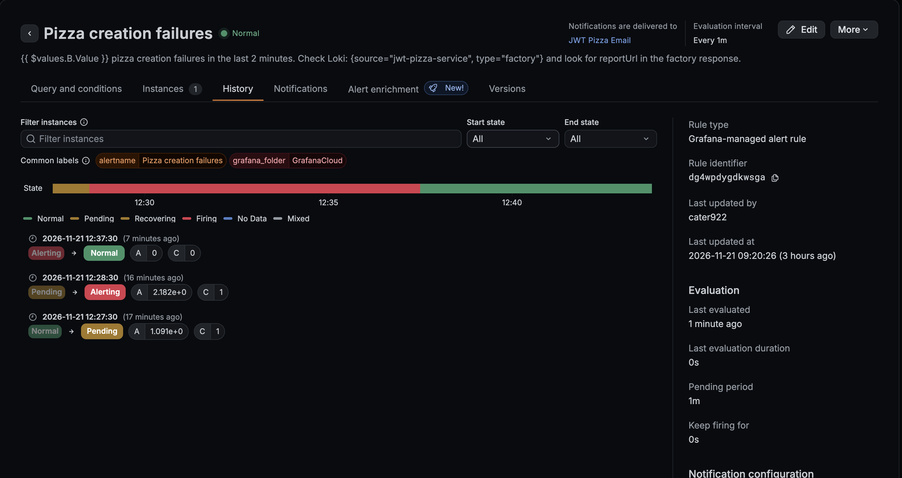
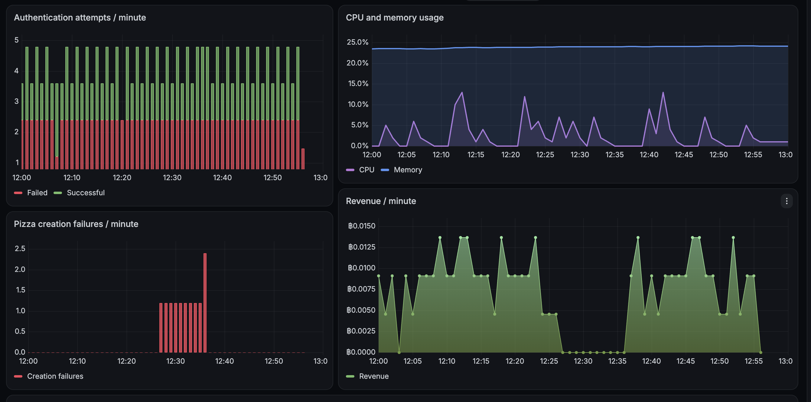
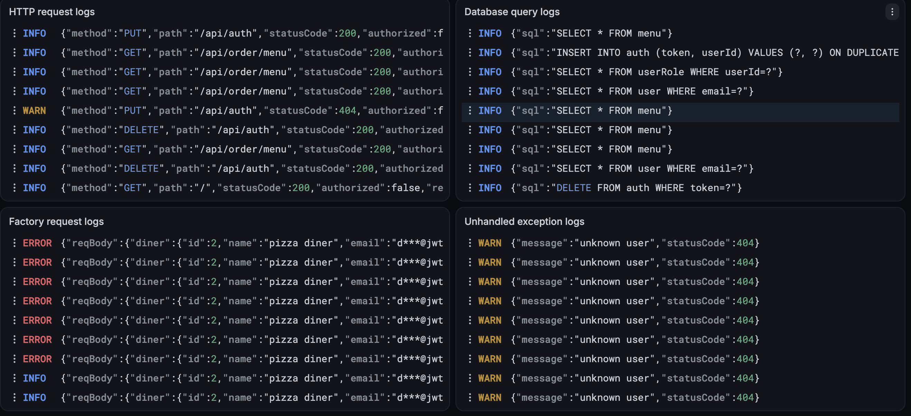

# Incident: 2026-11-21 12-27-00

## Summary

Between 12:27 and 12:36 MST on 2026-11-21, every pizza order placed through JWT Pizza failed with an HTTP 500 and the message "Failed to fulfill order at factory." The event was triggered by an injected failure (chaos) in the third-party Pizza Factory service that JWT Pizza calls to make each pizza. The JWT Pizza service itself was healthy the whole time; it correctly passed the factory's failure back to the diner.

The event was detected by the Grafana "pizza failures" alert. The on-call engineer found the factory's support link in the failed order response, followed it to report the problem, and the factory recovered at 12:36 MST. This was a high-severity incident because it fully blocked the core purchase flow, but it was short: 11 orders (100% of orders placed during the ~9 minute window) failed, and no other features (login, menu, franchises) were affected.

## Detection

This incident was detected by the Grafana **Pizza creation failures** alert. The rule went to Pending at 12:27:30 MST, right after the first failed orders (12:27 MST), and fired at 12:28:30 MST after its 1-minute pending period. Grafana IRM/OnCall notified the on-call engineer (Cate Allen) by email at about 12:29 MST, and the alert was acknowledged at 12:33 MST, about 4.5 minutes after it fired. The alert description already included the Loki query (`{source="jwt-pizza-service", type="factory"}`) and told the engineer to look for `reportUrl`, which made the cause quick to find.

Detection took about 1.5 minutes, one of which was the pending period; since even a single factory failure means a diner could not get their pizza, the pending period could be lowered to 0. Most of the delay was the engineer noticing the email. Adding a phone/SMS or push notification in Grafana IRM would make the page harder to miss and could cut time-to-acknowledge in half.

## Impact

For about 9 minutes between 12:27 and 12:36 MST on 2026-11-21, users could not buy pizza. Every order attempt returned HTTP 500 and the diner saw an order failure message.

This incident affected 11 orders, which was 100% of orders placed during the window (about 2% of the 532 orders placed during the full 8:00–15:37 MST test period). Menu browsing, login, and franchise features kept working normally. No revenue was collected for the failed orders.

No support tickets or social media posts were submitted.

## Timeline

All times are Mountain Standard Time (MST).

- _08:00_ - Chaos window begins (8:00–15:00 MST); simulated traffic running against production with `generateTraffic.sh --no-failures`
- _12:27_ - First order fails at the factory with HTTP 500; all orders fail from this point
- _12:27:30_ - Pizza creation failures alert goes to Pending
- _12:28:30_ - Alert fires after its 1-minute pending period; on-call engineer is notified by email (received ~12:29)
- _12:33_ - Alert acknowledged in Grafana IRM
- _12:35_ - Test order placed as a diner to inspect the failure; response contains `"Failed to fulfill order at factory"` and a `followLinkToEndChaos` link. Loki factory logs (`{source="jwt-pizza-service", type="factory", level="error"}`) show the same factory error
- _12:35_ - Engineer follows the factory support link to report the failure
- _12:36_ - First successful order after the outage; orders return HTTP 200 from here on
- _12:37:30_ - Pizza creation failures alert auto-resolves to Normal in Grafana
- _13:07_ - A pizza latency **NoData** alert fires. Investigation shows orders still succeeding with ~0.27s latency, so this was a false alarm caused by a brief gap in metric data, not further chaos
- _15:37_ - Traffic generation stopped after the chaos window ended at 15:00 with no further incidents

## Response

After receiving the alert email at about 12:29 MST, the on-call engineer (Cate Allen) came online and acknowledged it in Grafana IRM at 12:33 MST.

The engineer checked the traffic generator's output, which confirmed that every order was returning HTTP 500 while everything else returned 200. A test order and the Loki factory logs both showed the failure was coming from the Pizza Factory, not from the JWT Pizza service. The factory's response included a support link, which the engineer followed to report the problem. No escalation was needed. There were no major obstacles; the main delay was the ~4 minutes between the alert email and acknowledgment.

## Root cause

The Pizza Factory, a third-party dependency, began rejecting all order requests. Because JWT Pizza depends on the factory to make every pizza and has no fallback, every factory failure became a failed customer order.

## Resolution

Service was restored by following the `reportUrl` / `followLinkToEndChaos` support link that the factory includes in its failure response. This reported the problem to the factory, which then resumed fulfilling orders. Recovery was confirmed when orders returned HTTP 200 again at 12:36 MST, the failure panel dropped back to zero, and the pizza failures alert resolved.

No code changes were required. To cut time to mitigation, the factory's error response (including the support link) is already logged to Loki, so the on-call engineer can go straight from the alert to the link. Adding a link to that Loki query in the alert's notification would save the step of searching for it.

## Prevention

This is the first incident with this root cause. A previous chaos test (deliverable 10) exercised failures inside the JWT Pizza service itself, but not failures in the Pizza Factory.

## Action items

1. Add phone/SMS or push notifications in Grafana IRM so the on-call engineer sees pages faster than by email alone.
1. Lower the pending period on the pizza creation failures alert from 1 minute to 0 so it fires on the first factory failure.
1. Set **Alert state if no data** to **Normal** on event-based rules (pizza latency and pizza failures) to stop false NoData pages. Keep NoData alerting on the service-down rule.
1. Show a clearer "the kitchen is having trouble, please try again shortly" message to diners when the factory fails, instead of a generic error.
